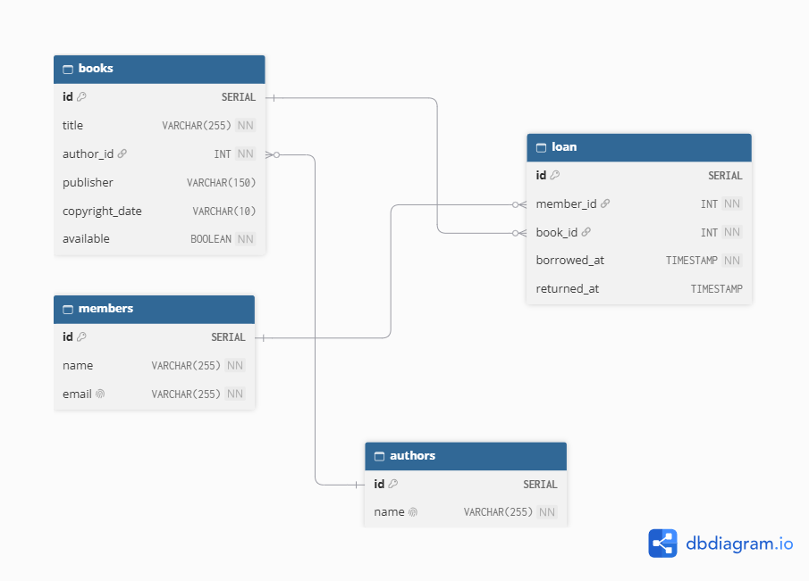

# Library-Management-System
A library management system that can borrow and return books with exceptions

## Features

- Add sample members and books
- Borrow a book (member and book are validated)
- Return a book
- Display books, members (with their borrowed books) and current loans
- Custom exceptions: `MemberNotFoundException`, `BookNotFoundException`, `BookNotAvailableException`
- Availability check (`UPDATE ... WHERE available = TRUE`) so a book cannot be borrowed twice
- Transactional borrow and return on `borrowBooks`
- Normalized schema (3NF) with a separate `authors` table
- Indexes on foreign keys, plus a partial unique index so a book can only have one active loan

Relationships: 
- one author may have zero to many books
- one member may have zero to many loans
- One book may have zero to many loans.

PostgreSQL does not index foreign keys automatically, so `loan(member_id)` and `books(author_id)` are indexed manually or explicitly in `db/schema.sql`.

Indexing helps retrieve the specific data you requested by using the index instead of scanning the entire database just to find one of the data. This helps reduces the time to execute queries and improves the database performance especially having millions of data stored.

## Project Structure

```
db/
  ER_Library_Diagram.png
  schema.sql
src/main/java/com/example/librarymanagementsystem/
  config/            DB, DatabaseConfig
  Book.java
  Member.java
  Library.java
  BookNotFoundException.java
  MemberNotFoundException.java
  BookNotAvailableException.java
  LibraryManagementSystemApplication.java
src/main/resources/
  application.properties
  db.properties.example
```

## Database Schema



Four tables, defined in `db/schema.sql`:

- `authors` (id, name `unique`)
- `books` (`PK` id, title, `FK` author_id, publisher, copyright_date, available)
- `members` (`PK` id, name, email `unique`)
- `loan` (id, `FK` member_id, `FK` book_id, borrowed_at, returned_at)

## How to Run Locally

Prerequisites: currently using JDK 26 (you can use JDK 17), Maven, PostgreSQL.

1. Create a database, for example `library_db` which I used.
2. Create the tables:
   ```
   psql -U your_username -d library_db -f db/schema.sql
   ```
3. Copy `src/main/resources/db.properties.example` to `src/main/resources/db.properties` and fill in your values:
   ```
   db.url=jdbc:postgresql://localhost:5432/library
   db.username=your_username
   db.password=your_password
   ```
   `db.properties` is listed in `.gitignore` so your password is not committed and be seen on github.
4. Run `LibraryManagementSystemApplication` from your IDE, or with `mvn spring-boot:run`.

## Usage


### The app shows a menu:

```
1. Add sample members and books
2. Borrow book
3. Return book
4. Display library records
0. Exit
```